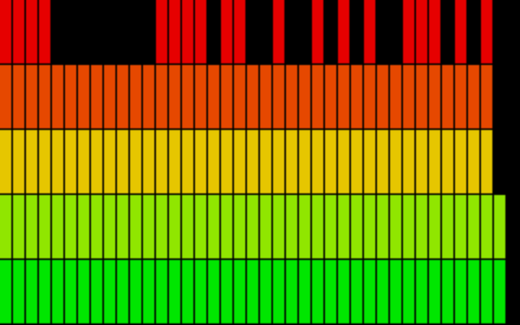
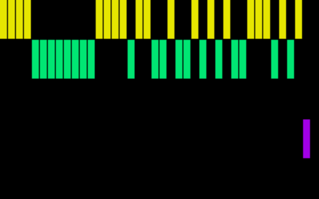
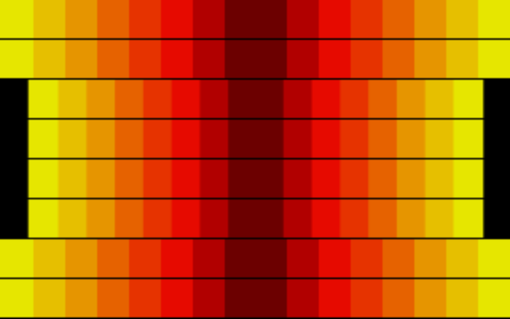
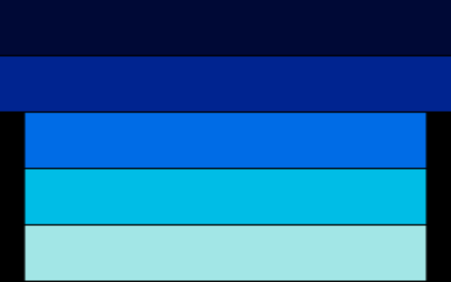

# Custom Audio Visualizer for SignalRGB

A [SignalRGB](https://www.signalrgb.com/) Lightscript audio-reactive effect: five render modes (Bars, Dots, Center, Kitt, Waterdrop), six palette presets, auto-gain, log-scale frequency banding, and adjustable band/color-level counts. Canvas-based, so it drives every device SignalRGB controls — keyboards, strips, anything — not just one specific product.

Port of the render logic from [`audio-visualizer-gui`](../audio-visualizer-gui), a standalone Rust/egui tool that does the same thing directly over QMK/VIA for custom keyboards. This version runs as a regular SignalRGB effect instead, using SignalRGB's own `engine.audio` API.

**Tags:** `signalrgb`, `lightscript`, `audio-visualizer`, `equalizer`, `rgb`, `javascript`, `canvas`

## Features

- **5 render modes** — Bars (filled columns), Dots (outline peaks only), Center (horizontal bars from center, color by distance), Kitt (same, solid color per row), Waterdrop (bass-triggered expanding rings)
- **6 palette presets** — Winamp, Purple, Ice, Fire, Neon, Ocean
- **Auto-gain** — each frequency band tracks its own running peak and normalizes to it, so the effect adapts to quiet and loud sources without manual tuning
- **Log-scale frequency banding** (toggle) — more resolution for bass, less for highs, instead of linear chunking
- **Adjustable band count** (8–80) and **color levels** (1–40, interpolated between each palette's 5 stops)
- **Silence threshold** — stops reacting once there's genuinely no audio playing, instead of drifting on noise floor
- **Brightness cap**, **decay speed**, **bass threshold** (Waterdrop trigger sensitivity)

## Screenshots

| Bars — Winamp | Dots — Neon |
|---|---|
|  |  |

| Center — Fire | Kitt — Ocean |
|---|---|
|  |  |

| Waterdrop — Purple |
|---|
|  |

Rendered headlessly from the actual effect code with a mocked `engine.audio` feed — not screen captures of a real audio source, just representative previews of each mode/palette combination.

## Install

1. Copy `CustomAudioBars.html` into SignalRGB's user effects folder:
   - Linux: `~/Documents/WhirlwindFX/Effects/`
   - Windows: `Documents\WhirlwindFX\Effects\`
2. Restart SignalRGB (or reload the effects library).
3. Find it under "Keyboard Visualizer Port" in the effects library, apply it to any device, adjust the controls (Effect Mode, Palette, Bar Count, Color Levels, etc.) in its settings panel.

No Pro subscription required — this is a plain user-sideloaded Lightscript.

## Why

SignalRGB's built-in "Audio Spectrum" effect is free but has very limited settings (no mode/palette choice), and some of the more capable audio visualizers are Pro-gated. This is a from-scratch replacement with more controls, built to match the look of an existing custom keyboard RGB tool rather than to mimic SignalRGB's own stock effect.

## License

MIT
